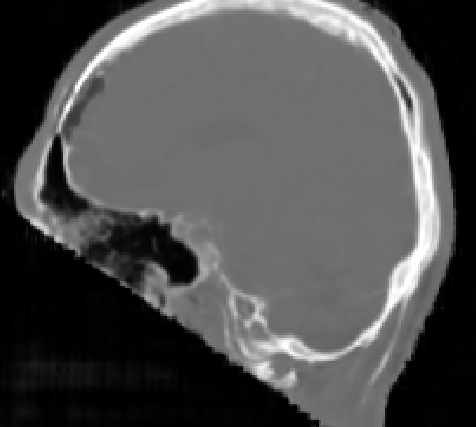

# MR to CT

3D Slicer extension that generates a **synthetic CT** (in Hounsfield units) from a **brain MR** with a
deep-learning model (SAdaNGF), for radiotherapy research.

> **License: CC BY-NC 4.0 (non-commercial use only).**
> **Research use only: the synthetic CT is not validated for clinical use or treatment planning.**



## Module

- **MR to CT** (category *Radiotherapy*): select an MR volume and click *Generate synthetic CT*. The sCT
  is created on the same grid as the MR.

## Installation

1. Install 3D Slicer (5.8 or later).
2. Open the Extensions Manager, search for **MRtoCT**, install it and restart Slicer.
   This also installs the *PyTorch* extension. For GPU use, install a CUDA build of PyTorch with the
   *PyTorch Utils* module.
3. On the first run, the module asks you to accept the license and downloads the model
   (about 145 MB, once). Only PyTorch is needed (no MONAI).

## How it works

The MR is scaled to [-1, 1] (percentiles 1 and 99.9), resampled to 1 mm isotropic, translated with
128³ sliding windows (overlap 0.8, gaussian blending) and resampled back to the MR grid. The generator
output in [-1, 1] is mapped to [-1000, 2000] HU. Everything is in `MRtoCT/MRtoCTLib/mr_to_sct.py`, which
also runs outside Slicer (it only needs numpy, torch and nibabel):

```bash
python mr_to_sct.py INPUT OUTPUT_FOLDER     # INPUT: an MR .nii.gz, or a folder (every .nii.gz in it)
```

## Citation

If you use this extension, please cite: *(add your publication here)*.

## License

Code and model weights: [Creative Commons Attribution-NonCommercial 4.0 International](https://creativecommons.org/licenses/by-nc/4.0/)
(see [LICENSE.txt](LICENSE.txt)). Copyright (c) 2026 Kevin Estiven Giraldo Paniagua.
